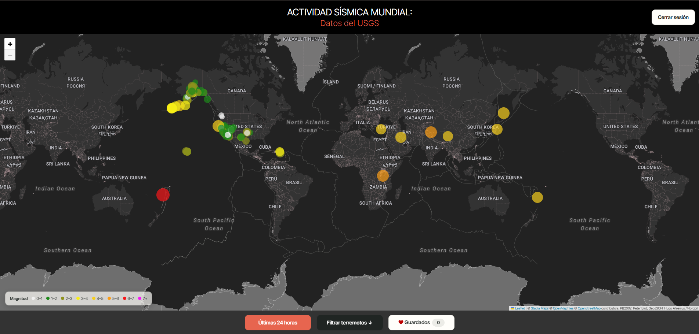
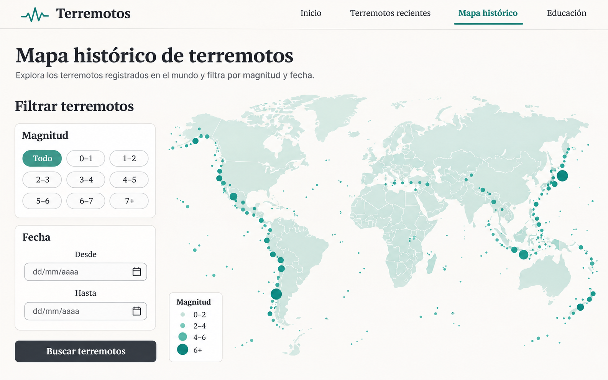

# Proyecto terremotos

Aplicación web para consultar y explorar terremotos de todo el mundo. Muestra en un mapa los eventos recientes del Servicio Geológico de Estados Unidos (USGS), permite filtrar eventos por magnitud y fecha, y ofrece guardar terremotos favoritos en una cuenta de Google.

La interfaz está en español y utiliza dos mapas Leaflet: uno oscuro para la actividad reciente y otro claro para los resultados filtrados.

## Vista previa



Imagen de presentación editada a partir de la aplicación. Es ilustrativa: los marcadores y los nombres del mapa no son una captura de datos en tiempo real.

### Mapa de terremotos filtrados



Diseño ilustrativo del segundo mapa y su formulario de filtros. Los puntos y el mapa son de ejemplo, no representan resultados en tiempo real.

## Funcionalidades

- **Actividad de las últimas 24 horas:** carga el feed GeoJSON diario del USGS y representa los eventos con marcadores circulares.
- **Información del evento:** al seleccionar un marcador se abre una ficha con título, fecha, lugar, código, magnitud y tipo de magnitud.
- **Mapa de favoritos:** permite iniciar sesión con Google, consultar los terremotos guardados por la cuenta y quitarlos de favoritos.
- **Filtros históricos:** consulta eventos del catálogo del USGS y permite limitar los resultados por intervalo de magnitud y fechas de inicio y fin.
- **Límites de placas tectónicas:** dibuja las fronteras de placas sobre los dos mapas.
- **Leyenda de magnitudes:** relaciona los colores de los marcadores con sus rangos de magnitud.
- **Carga y navegación:** muestra indicadores mientras consulta los datos y ofrece controles para pasar entre el mapa reciente y la sección de filtros.

## Tecnologías y servicios

| Tecnología o servicio | Uso en el proyecto |
| --- | --- |
| HTML | Estructura de la página, encabezados, mapas y formulario de filtros. |
| CSS | Diseño, disposición de los paneles, botones, leyendas, estados de carga y adaptación de los filtros. |
| JavaScript ES modules | Consultas de datos, creación de mapas, interacción de marcadores y navegación. |
| [Leaflet 1.9.4](https://leafletjs.com/) | Mapas interactivos y marcadores. Se carga desde un CDN. |
| [USGS Earthquake Hazards Program](https://earthquake.usgs.gov/earthquakes/feed/v1.0/geojson.php) | Feed reciente y catálogo de terremotos en GeoJSON. |
| [Firebase Authentication](https://firebase.google.com/docs/auth) | Inicio y cierre de sesión con Google. |
| [Cloud Firestore](https://firebase.google.com/docs/firestore) | Almacenamiento de los favoritos asociados a cada usuario. |
| Stadia Maps y OpenStreetMap | Teselas cartográficas y datos base de los mapas. |
| Google Fonts: Inter Tight | Tipografía de la interfaz. |
| GeoJSON de PB2002 | Fronteras tectónicas servidas desde el repositorio `fraxen/tectonicplates`. |

Las dependencias se cargan desde servicios externos. El proyecto no usa actualmente un gestor de paquetes ni un proceso de compilación.

## Estructura del proyecto

```text
proyecto_terremotos/
├── index.html   # Estructura, mapas, leyendas, formulario y controles
├── style.css    # Tipografía, distribución, tarjetas, chips y estilos de mapa
├── script.js    # Leaflet, consultas USGS, autenticación y favoritos
└── README.md    # Documentación del proyecto
```

## Requisitos

- Un navegador moderno con JavaScript habilitado.
- Conexión a Internet para cargar USGS, Firebase, Leaflet, Stadia Maps, Google Fonts y los datos tectónicos.
- Un servidor web local para servir `index.html` y permitir que el navegador cargue `script.js` como módulo.
- Un proyecto Firebase configurado si se quieren utilizar la autenticación y los favoritos.

## Ejecutar en local

No abras el archivo con doble clic (`file://`): los módulos JavaScript y las llamadas a servicios externos pueden no funcionar desde ese esquema. Inicia un servidor local desde la carpeta del proyecto.

### Con Python

En PowerShell o una terminal, dentro de `proyecto_terremotos`, ejecuta:

```powershell
py -m http.server 8000
```

Si el comando `py` no está disponible, prueba:

```powershell
python -m http.server 8000
```

Abre después [http://localhost:8000](http://localhost:8000). Para detener el servidor, vuelve a la terminal y pulsa `Ctrl+C`.

También puedes utilizar una extensión de servidor local para tu editor, como Live Server de Visual Studio Code.

## Configurar Firebase

La integración de Firebase está en `script.js`. Para usar una instancia propia:

1. Crea un proyecto en Firebase y registra una aplicación web.
2. Activa **Google** como proveedor en Authentication.
3. Crea una base de datos de Cloud Firestore.
4. Copia la configuración web de Firebase en el objeto `firebaseConfig` de `script.js`.
5. Autoriza `localhost` en los dominios permitidos de Authentication durante el desarrollo local.
6. Configura reglas de Firestore para que cada usuario solo pueda leer o borrar documentos cuyo campo `uid` coincida con su UID autenticado.

La configuración web de Firebase se incluye en el cliente. La autorización de acceso debe hacerse con reglas de Firestore; no se debe confiar en ocultar la configuración en el navegador como mecanismo de seguridad. No incluyas claves privadas de cuentas de servicio en este proyecto.

### Reglas básicas para la colección de favoritos

El código guarda documentos en `proyecto_terremotos`. Estas reglas ilustran cómo limitar cada documento a su propietario:

```text
rules_version = '2';
service cloud.firestore {
  match /databases/{database}/documents {
    match /proyecto_terremotos/{favoriteId} {
      allow read, delete: if request.auth != null
        && resource.data.uid == request.auth.uid;
      allow create: if request.auth != null
        && request.resource.data.uid == request.auth.uid;
      allow update: if false;
    }
  }
}
```

Estas reglas son una base para el esquema actual. Revísalas y ajústalas si cambia la aplicación. La consulta que comprueba si un evento ya está guardado combina `code` y `uid`; Firestore puede pedir crear un índice compuesto y mostrará un enlace para generarlo si hace falta.

### Esquema de un favorito

Cada documento de `proyecto_terremotos` almacena:

| Campo | Contenido |
| --- | --- |
| `uid` | UID de la cuenta de Firebase que guardó el evento. |
| `code` | Código del evento en el USGS. |
| `coordinates` | Coordenadas GeoJSON, en orden longitud, latitud y profundidad cuando está disponible. |
| `date` | Fecha y hora formateadas para mostrar en la interfaz. |
| `mag` | Magnitud del terremoto. |
| `magType` | Tipo de escala de magnitud indicado por el USGS. |
| `place` | Descripción del lugar del evento. |
| `title` | Título recibido del USGS. |

## Cómo funciona

### Mapa de las últimas 24 horas

`script.js` consulta el feed `all_day.geojson` del USGS. Convierte las coordenadas GeoJSON a latitud y longitud para dibujar cada evento en Leaflet. El tamaño del marcador crece con la magnitud y el color se asigna por intervalos:

| Magnitud | Color |
| --- | --- |
| Menor que 1 | Gris claro |
| 1–2 | Verde |
| 2–3 | Verde oliva |
| 3–4 | Amarillo |
| 4–5 | Amarillo dorado |
| 5–6 | Naranja |
| 6–7 | Rojo |
| 7 o superior | Magenta |

Las fechas de los eventos se presentan en la zona horaria `Europe/Madrid`. Al abrir un marcador, la persona puede consultar el evento y añadirlo o quitarlo de sus favoritos.

### Filtros y mapa histórico

El formulario recoge un intervalo de magnitud y dos fechas opcionales. La aplicación construye una consulta al servicio FDSN del USGS y después aplica el rango de magnitud seleccionado a los resultados GeoJSON:

- `Todo`: no restringe la magnitud.
- `0–1`, `1–2`, …, `6–7`: incluye el límite inferior y excluye el superior.
- `7+`: incluye magnitudes iguales o mayores que 7.

Las fechas se envían como `starttime` y `endtime`. El resultado aparece en el segundo mapa, con una base cartográfica clara.

### Límites de placas tectónicas

La función `tectonicPlates` obtiene las fronteras del archivo GeoJSON PB2002 y las dibuja en ambos mapas con `L.geoJSON`.

### Favoritos

La autenticación usa una ventana emergente de Google. Los favoritos se consultan en Firestore filtrando por el UID actual. El código del evento se utiliza junto con el UID para comprobar si ese usuario ya lo había guardado.

## Archivos principales

### `index.html`

Define el documento en español, carga Leaflet, los estilos del proyecto, Inter Tight y el módulo `script.js`. También contiene los dos contenedores de mapa, las leyendas, el formulario y los botones. Los identificadores de estos elementos son utilizados por JavaScript; conviene conservarlos al editar el HTML.

### `style.css`

Controla la apariencia de la aplicación: tipografía, cabecera, mapa, leyendas, tarjetas de filtros, opciones de magnitud, fechas, botones, popups y mensajes. Los rangos de magnitud se presentan como chips seleccionables; los campos de fecha se apilan y se centran dentro de su tarjeta.

### `script.js`

Inicializa Firebase y los dos mapas Leaflet; consulta los datos del USGS y las placas tectónicas; crea los marcadores y popups; gestiona el filtrado; y responde a la autenticación y las acciones de favoritos.

## Fuentes de datos y atribución

- Terremotos recientes: [USGS GeoJSON Summary Feeds](https://earthquake.usgs.gov/earthquakes/feed/v1.0/geojson.php).
- Catálogo histórico: [USGS FDSN Event Web Service](https://earthquake.usgs.gov/fdsnws/event/1/).
- Fronteras tectónicas: [PB2002 GeoJSON de fraxen/tectonicplates](https://github.com/fraxen/tectonicplates).
- Teselas: [Stadia Maps](https://stadiamaps.com/) con datos de [OpenStreetMap](https://www.openstreetmap.org/copyright) y [OpenMapTiles](https://openmaptiles.org/). Leaflet muestra la atribución de cada capa en los mapas.

## Solución de problemas

- **El mapa queda vacío:** comprueba la conexión a Internet y que Leaflet y las teselas de Stadia Maps se carguen sin errores en la consola del navegador.
- **No aparecen los terremotos:** revisa la disponibilidad del servicio del USGS y los errores de red en las herramientas de desarrollo del navegador.
- **Google no abre la sesión:** confirma que Google está activado como proveedor de Firebase Authentication y que el dominio de desarrollo está autorizado.
- **No se guardan o muestran favoritos:** revisa las reglas de Firestore, el nombre de la colección `proyecto_terremotos` y los posibles índices solicitados por Firestore.
- **El navegador bloquea el módulo:** sirve la carpeta desde `http://localhost` en lugar de abrir el HTML directamente como archivo local.

## Desarrollo y pruebas

El repositorio no contiene `package.json`, herramientas de compilación ni una suite de pruebas automatizadas. Los cambios se pueden revisar sirviendo la carpeta localmente y comprobando ambos mapas, el formulario y el flujo de autenticación en el navegador.
